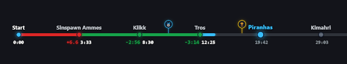
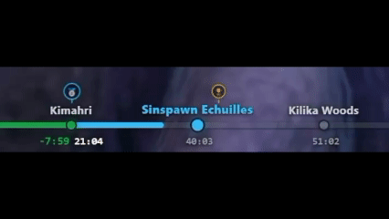
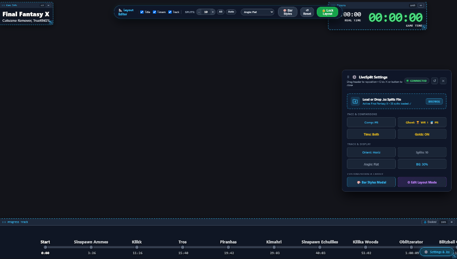
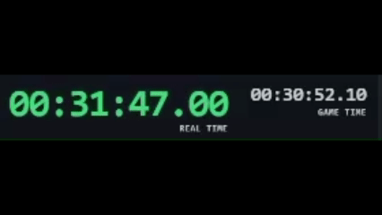
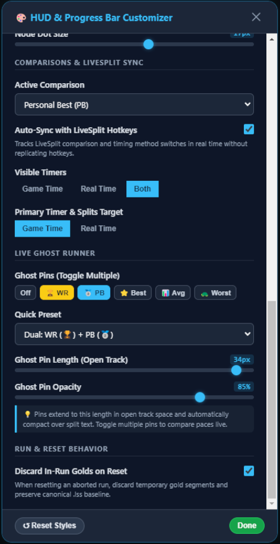

# LiveSplit Progress Bar

<p align="center">
  <a href="https://github.com/lukeroddis/Livesplit-Progress-Bar/actions/workflows/ci.yml"></a>
  <a href="tests/run_tests.py"></a>
  <a href="tests/run_tests.py"></a>
  <a href="https://obsproject.com/"></a>
  <a href="https://github.com/lukeroddis/Livesplit-Progress-Bar/releases"></a>
  <a href="https://github.com/lukeroddis/Livesplit-Progress-Bar/issues"></a>
  
</p>

<p align="center">
  
</p>

A modern, minimalist HUD and progress bar overlay for speedrunners, optimized for standalone web browsers and OBS Studio Browser Sources (1080p, 1440p, 4K).

Traditional LiveSplit layouts consume substantial vertical screen space over modern 16:9 gameplay. This overlay delivers a sleek, non-intrusive progress timeline with fully repositionable HUD components, dynamic dual timers, live ghost runner pacing, and per-game layout profiles.

---

## 📋 Prerequisites & Compatibility

| Software | Minimum Version | Recommended | Notes |
| :--- | :--- | :--- | :--- |
| **LiveSplit** | **v1.8.30+** (or v1.7.0+ with legacy `LiveSplit.Server.dll`) | **v1.8.37+** | Built-in WebSocket server under `Control → Start WebSocket Server` (zero external DLLs required). |
| **OBS Studio** | **v27.2+** | **v29.0+** (or 30+) | Supports modern Chromium browser sources, hardware acceleration, and CSS `backdrop-filter` frosted glass blur. |
| **Desktop Browsers** | Chrome 90+, Edge 90+, Firefox 90+ | Latest | For standalone browser display and multi-monitor setups. |

---

## ⚡ Quick Start (60 Seconds)

1. **Start LiveSplit WebSocket Server**:
   * **LiveSplit v1.8.30+ (Recommended)**: Right-click LiveSplit → **Control** → **Start WebSocket Server** (default: `ws://localhost:16834/livesplit`).
     * *Tip (v1.8.37+)*: In `Right-click → Settings`, check the option to automatically start the WebSocket server whenever LiveSplit opens.
   * **Older LiveSplit versions (v1.7.0 – v1.8.29)**: Right-click → **Edit Layout** → add **Control → LiveSplit Server**, then right-click → **Control → Start Server**.
   * *(Important: Select **WebSocket Server**, not TCP Server, as browser overlays communicate via WebSockets).*
2. **Open the Overlay**:
   * Download the latest `livesplit-minimal-overlay-v*.html` from [Releases](https://github.com/lukeroddis/Livesplit-Progress-Bar/releases). The release is one fully self-contained HTML file; no server or companion files are required.
   * **In OBS Studio (Recommended)**: Add a **Browser Source** pointing to the downloaded HTML file, set resolution to `1920×1080` (or match your canvas resolution), and check *"Shutdown source when not visible"*.
   * **In Desktop Browser**: Open the downloaded HTML file in Chrome, Edge, or Firefox.
3. **Load Your Splits**:
   * Drag and drop your `.lss` splits file directly onto the window. Splits, targets, and history are cached locally.

---

## 🧑‍💻 Development

Building from source requires Node.js `^20.19.0` or `>=22.12.0`; the test suite also requires Python 3.11.

```bash
npm ci
npm run dev      # Vite dev server with live reload
npm test         # Python + in-browser test suite
npm run build    # → dist/index.html (single self-contained file)
```

The application source remains classic, dependency-free scripts. `vite.config.mjs` swaps the script tags for [src/build-entry.js](src/build-entry.js) during a build, and `vite-plugin-singlefile` inlines the resulting JS and CSS. The `postbuild` check ([scripts/verify-single-file.mjs](scripts/verify-single-file.mjs)) fails the build if `dist/` contains anything other than `index.html` or if the output references an external asset. The source [index.html](index.html) can still be opened directly for quick debugging, but the supported distribution is the built single file.

---

## 🎮 Key Features

### 1. Minimalist Split Progress Track

<p align="center">
  
</p>

* **Non-Intrusive Timeline**: Smooth auto-centering progress bar available in both **Horizontal** (widescreen bottom bar) and **Vertical** (classic sidebar) orientations.
* **4-State LiveSplit Coloring**: Accurate delta state colors for ahead/behind and gaining/losing time, plus vivid gold highlights when beating your Personal Best segment.
* **Prominent Overdue Split Glow**: When you exceed the target segment time, the current split bar chunk pulses with an eye-catching red glow to keep you instantly aware of lost pace.
* **Smart 40° Angle Tilt**: Automatically tilts split titles at 40° when split density increases, while keeping deltas strictly horizontal on the opposing side to prevent overlap.

---

### 2. Interactive HUD Layout Editor & Game Profiles

<p align="center">
  
</p>

* **Freeform Drag & Scale**: Press **`E`** (or **`F2`**) to enter Edit Mode. Drag components anywhere on screen, scale them smoothly from `40%` to `250%` with the bottom-right grip (**`⤡`**), or snap the track to the bottom dock (**`⚓`**).
* **Game Layout Profiles**: Save custom layouts for different games (e.g. 16:9 widescreen dock vs. 4:3 retro sidebar). The overlay automatically loads matching profiles when connecting to LiveSplit or loading a `.lss` file.
* **OBS-Friendly Import & Export**: Export clean, human-readable JSON files ([schema/layout-v1.json](schema/layout-v1.json)) or use one-click clipboard copying and pasting inside OBS Browser Source to bypass CEF file-download limitations.

---

### 3. Live Ghost Runner Comparison

* **Real-Time Racing Pace**: A sleek, glowing marker advances along the progress track in real time showing where a comparison run was at that exact second (**World Record `🏆`**, **Personal Best `🥈`**, **Best Segments `⭐`**, or **Average `📊`**).
* **Off-Screen Edge Beacons**: When the ghost is outside your visible split window, subtle pulsing pills appear at the track edges (`❮ 🏆 -14.2s` or `+18.5s 🏆 ❯`) showing the live gap and direction without visual clutter.
* **Customizable Markers**: Adjust ghost pin length (including `0px` for a needleless track glide) and pin opacity via the Bar Styles modal.

---

### 4. Dynamic Dual Timers & Custom Game Logo

<p align="center">
  
</p>

* **Dual Timer Focus**: Display **Game Time**, **Real Time**, or **Both**. Click directly on either timer block to make it the primary focused timer and benchmark split comparisons against it.
* **Custom Game Logo**: Replace the default text title with a high-resolution PNG, SVG, or WebP logo via one-click upload in the Bar Styles modal.
* **Glassmorphic Contrast Plates**: Protect text readability over bright games (skyboxes, snow, bright track surfaces) with customizable frosted glass backdrop blur and opacity.

<p align="center">
  
</p>

---

## 🎛️ OBS Hotkeys & URL Parameters

| Control / Hotkey | Action |
| :--- | :--- |
| **`C`** (or **`NumPad 6`** / **`]`**) | Cycle forward to next comparison time (with HUD toast) |
| **`Shift + C`** (or **`NumPad 4`** / **`[`**) | Cycle backward to previous comparison time (with HUD toast) |
| **`Scroll Wheel`** | Scroll splits left/right (or up/down if sidebar) like LiveSplit |
| **`←` / `→`** (or **`↑` / `↓`**) | Pan splits / browse future and previous splits with keyboard arrow keys (works in continuous and windowed mode with pinned last split) |
| **`E`** or **`F2`** | Toggle Interactive Layout Edit Mode (Drag & Scale) |
| **`Esc`** | Exit Edit Mode or close open modals |
| **`Settings`** | Bottom-right discreet pill to configure styles, profiles, and drop `.lss` files |

For multi-scene or automated OBS setups, configure sources instantly with query parameters:

| URL Parameter | Description | Example |
| :--- | :--- | :--- |
| `?profile=Name` | Load a saved named layout profile | `index.html?profile=Mario+64` |
| `?timer=gametime\|realtime\|both` | Set timer visibility mode | `index.html?timer=gametime` |
| `?orient=horizontal\|vertical` | Set track orientation | `index.html?orient=vertical` |
| `?splits=all\|auto\|<count>` | Configure visible split density | `index.html?splits=12` |
| `?ghost=wr\|pb\|best\|off` | Set live ghost runner target | `index.html?ghost=wr` |
| `?bg=0..95` | Set background plate opacity percentage | `index.html?bg=55` |
| `?logo=path/to/logo.png` | Set custom logo image path | `index.html?logo=logo.png` |

---

## 🧪 Testing & Code Stability

The repository includes an automated test suite verifying data parsers, ghost interpolation, DOM consistency, and layout schema compatibility:

```bash
# Run automated tests and static checkers (or: npm test)
python tests/run_tests.py

# Verify the single-file build contract
npm run build
```

* **In-Browser Test Runner**: Open [tests/test_runner.html](tests/test_runner.html) in any browser to inspect assertions visually with live status badges.
* **Automated Pre-Push Hook**: Local tests run automatically before every `git push` via `.githooks/pre-push`.
* **GitHub Actions CI**: Automated tests and the single-file build run on every push and pull request via [.github/workflows/ci.yml](.github/workflows/ci.yml).
* **Release Build**: Releases publish a standalone `livesplit-minimal-overlay-<tag>.html` built and verified by CI.

---

## 🛠️ Developer & AI Agent Guide

For WebSocket architecture details, LiveSplit protocol constraints, algorithm specifications, and layout schema definitions, refer to:

👉 **[Agent & Developer Architecture Guide (AGENT_GUIDE.md)](AGENT_GUIDE.md)**

---

## 🔮 Future Roadmap & Proposals

For post-v1.0.0 feature specifications and technical explorations, see:

* 🏁 **[Live Race Ghost Pins & F1-Style Dynamic Leaderboard](docs/proposals/live-race-ghosts-and-leaderboard.md)**: Feasibility study and technical specification for connecting online races from therun.gg with real-time multi-racer track pins and an animated broadcast timing tower.
* 🎨 **Custom Color Palette Overrides & Extended Theme Customization**:
  * **User-Defined Delta Palette**: Ability to customize hex colors for all 4 LiveSplit delta states (Ahead/Gaining, Ahead/Losing, Behind/Gaining, Behind/Losing), Gold splits, and the overdue red warning pulse.
  * **Accessibility Colorblind Presets**: One-click accessible presets optimized for Deuteranopia, Protanopia, and Tritanopia contrast guidelines.
  * **Custom Font & Typography Controls**: Selectable font families (retro monospace, modern geometric sans, digital 7-segment clock) and weight adjustments.
  * **Profile-Linked Themes**: Theme palettes saved directly inside game layout profiles (`schema/layout-v1.json`) to automatically match each game's visual aesthetic.

---

## 📄 License & Attribution

* **License**: Released under the [MIT License](LICENSE).
* **Attribution**: Developed with AI pair programming using **Google DeepMind Antigravity**, reviewed and approved by [@lukeroddis](https://github.com/lukeroddis).
