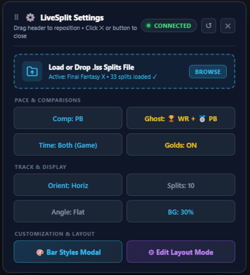

# LiveSplit Progress Bar

<p align="center">
  <a href="https://github.com/lukeroddis/Livesplit-Progress-Bar/actions/workflows/ci.yml"></a>
  <a href="tests/run_tests.py"></a>
  <a href="https://obsproject.com/"></a>
  <a href="https://github.com/lukeroddis/Livesplit-Progress-Bar/releases"></a>
  <a href="https://github.com/lukeroddis/Livesplit-Progress-Bar/issues"></a>
  
</p>

<p align="center">
  
</p>

A modern HUD and progress bar overlay for speedrunners, designed for standalone web browsers and OBS Studio Browser Sources (1080p, 1440p, 4K).

Traditional LiveSplit layouts can take up substantial vertical screen space over modern 16:9 gameplay. This LiveSplit Progress Bar delivers a minimalist approach, where the track, timers and game information can be split and move around freely, allowing speedrunners to customise their layout and maximise the real estate for the game.

The Progress Bar provides ample customisation of number of splits shown, horizontal/vertical layout, and the enabling of ghost pins where you can pace your current run against comparisons such as the World Record or Personal Best.

---

## ⚡ Quick Start Guide (60 Seconds)

### 1. Enable LiveSplit Server
1. In LiveSplit, right-click $\rightarrow$ **Edit Layout** $\rightarrow$ add **Control $\rightarrow$ LiveSplit Server**.
2. Right-click $\rightarrow$ **Control $\rightarrow$ Start Server** (defaults to `ws://localhost:16834`).

### 2. Open the Overlay
* **In Desktop Browser**: Open [index.html](file:///c:/Users/Luke/Livesplit-Progress-Bar/index.html) in Chrome, Edge, or Firefox.
* **In OBS Studio**:
  1. Add a **Browser Source** pointing to the local path of `index.html` (or your local web server).
  2. Set Width to `1920` and Height to `1080` (or your native canvas resolution).
  3. Enable **Shutdown source when not visible** and **Refresh browser when scene becomes active**.

### 3. Load Your Splits
* Simply **drag and drop** your LiveSplit `.lss` splits file directly onto the browser window.
* Your splits, PB targets, best segment histories, and metadata are automatically parsed and saved to local browser storage.

---

## 🎮 Key Features & Capabilities

### 1. Minimal Horizontal Split Track

<p align="center">
  
</p>

* **Visual Progress Nodes**: Interactive node dots and connecting lines indicate completed, current, and upcoming splits.
* **Auto-Centering Track**: Smoothly scrolls the active split to keep it centered on screen regardless of how many splits your run has.
* **Side-by-Side Typography**: Displays both the locked split delta and the final cumulative time side by side.
* **Accurate 4-State LiveSplit Coloring**:
  - Ahead & Gaining Time: Dark Green
  - Ahead & Losing Time: Light Green
  - Behind & Gaining Time: Light Red
  - Behind & Losing Time: Dark Red
  - Gold Split (Personal Best Segment): Vivid Gold / Yellow
* **Intelligent Live Delta Reveal**: Hides the active delta while on pace for a Gold split; dynamically reveals the ticking delta the moment time is lost.

### 2. Dynamic Dual Timers & Focus Control

<p align="center">
  
</p>

* **Flexible Display Modes**: Toggle between **Game Time**, **Real Time**, or **Both** using the footer `Time:` badge, the Bar Styles modal (`🎨 Bar Styles`), or URL query parameter (`?timer=gametime|realtime|both`).
* **Direct Click-to-Focus**: When both timers are displayed, click directly on either the **Game Time** (`#block-igt`) or **Real Time** (`#block-rta`) timer block to immediately focus that method as the primary timer (large 54px typography) and have split comparisons benchmark against it.
* **Secondary Timer (24px)**: Keeps the alternate time format visible with low visual intrusion.

### 3. Interactive HUD Layout Editor

<p align="center">
  
</p>

Edit and customize your layout in real time directly inside the browser or OBS Interact window:
* **Toggle Edit Mode**: Press **`E`** or **`F2`**, or click **`⚙ Edit Layout`** in the bottom utility bar.
* **Freeform Drag & Drop**: Click and drag any component header (`:::`) or container to move it anywhere on screen.
* **Proportional Scaling**: Drag the bottom-right resize grip (**`⤡`**) to scale any element smoothly from `40%` to `250%`. Typography and geometries scale proportionally.
* **Component Toggles**: Hide or show the **Game Title**, **Dual Timers**, or **Progress Track** independently.
* **Bottom Dock Snapping**: Drag the Progress Track near the bottom to snap to a full-width dock, or click **`⚓ Dock / ⛵ Float`**.
* **Lock & Save**: Press **`Esc`** or click **`🔒 Lock Layout`**. Layout settings are remembered across browser sessions and OBS reboots.
* **Demo Video**: See [assets/InteractiveHUD.mp4](assets/InteractiveHUD.mp4) for a live demonstration of interactive HUD manipulation.

### 4. High-Density Split Controls & 40° Angle Tilt
* **Spin Box Split Density**: Control exactly how many splits fit on screen with an integer spin box (`2` to `60` splits), or choose one-click **`All`** (fit all without scrolling) or **`Auto`** (standard 220px spacing).
* **Anti-Collision 40° Angle Tilt**:
  - Automatically rotates split titles at a 40° angle when split density increases.
  - **Opposing-Side Rule**: Deltas and times remain strictly flat (0°) and are forced to the opposite side of the connector bar (e.g. Titles on Top $\implies$ Timers on Bottom), eliminating text overlap.
  - Generous bounding box clearance prevents text clipping or truncation.

### 5. High-Contrast Glassmorphic Background Plates & HUD Customizer

<p align="center">
  
</p>

* Solves washed-out text and illegibility on bright game scenes (skyboxes, bright pavement, snow):
  - Dark semi-transparent plate (`rgba(15, 23, 42, opacity)`) with frosted glass backdrop blur.
  - **Live Opacity Slider**: Adjustable from `0%` (fully transparent) to `95%` (dark contrast).
  - **Presets**: `0% (Off)`, `35% Subtle`, `55% Glass`, `80% Dark`.
  - **Frosted Blur Slider**: Configurable from `0px` to `20px`.
  - **Component Control**: Toggle background plates independently on Game Title, Timers, or Track.

### 6. Custom Game Logo Image Option
Replace the standard LiveSplit text title with a high-resolution PNG, SVG, or WebP game logo:
* **One-Click Upload**: Upload any PNG, JPG, WebP, or SVG logo directly from the **🎨 Bar Styles** modal (`Upload Logo PNG/Image`).
* **LocalStorage Persistence**: Saved as a base64 Data URL, surviving OBS scene transitions, profile reloads, and browser restarts.
* **Responsive Height Control**: Adjust logo height from `25px` to `140px` via the modal slider, with full proportional scaling support in Layout Edit Mode (`E`).
* **Instant Revert**: Click `✕ Use Text Title` at any time to return to the LiveSplit text title.

### 7. Multiple Comparison Targets
Seamlessly switch target benchmarks:
* **Personal Best (PB)**
* **Best Segments (Sum of Best)**
* **Average Segments** (calculated dynamically from `<SegmentHistory>`)
* **Worst Segments** (calculated dynamically from `<SegmentHistory>`)
* **Custom Comparisons** (any comparison tracks declared in your `.lss` file)
* *Quick Cycle*: Click the **`Comp: PB`** badge in the bottom utility bar to cycle comparisons on the fly.

### 8. Live Ghost Runner Comparison (Live Racing Pace)
Bring the "ghost runner" mechanic from racing games directly to your speedrun HUD:
* **Interactive Ghost Pin**: A sleek, glowing marker advances along the progress track in real time to show where a comparison run was at that exact second:
  - **World Record (`🏆`)**: Shows World Record position live on the bar.
  - **Personal Best (`🥈`)**: Race against your Personal Best ghost.
  - **Best Segments (`⭐`)**: Race against your theoretical Sum of Best / Gold pace.
  - **Average Pace (`📊`)**: Race against your historical average run.
* **Smart Off-Screen Edge Beacons**: If the ghost is outside your visible split window in scrolling mode, subtle pulsing pills appear at the track edges (`❮ 🏆 -14.2s` or `+18.5s 🏆 ❯`), showing real-time gap and direction without clutter.
* **Zero-Clutter & Configurable**:
  - Completely optional (`Off` by default).
  - Configurable ghost pin length slider (`0px` to `36px`) in **`🎨 Bar Styles`**; set to `0px (On Track)` to hide the needle and let ghosts glide directly along the progress track.
  - Configurable ghost pin opacity slider (`30%` to `100%`) in **`🎨 Bar Styles`**.
  - Quick cycling via the **`Ghost: Off`** footer utility badge.

### 9. Vertical Sidebar Track (Classical LiveSplit & 4:3 Displays)
Bring the overlay into a clean vertical sidebar layout tailored for 4:3 pillarboxed displays and classic LiveSplit aesthetics:
* **Toggle Track Orientation**: Switch between **Horizontal** (widescreen default) and **Vertical** (sidebar) with a single click via the **`Orient: Horiz / Vert`** footer badge or the **`🎨 Bar Styles`** customizer modal.
* **Flexible Left / Right Text Positioning**:
  - **Symmetrical (Default Vertical)**: Split Names on the Left (right-aligned), Deltas on the Right (left-aligned), with the timeline dot centered.
  - **Classic LiveSplit**: Timeline dots on the left, Split Names left-aligned, and Deltas right-aligned.
  - **Customizable**: Choose any combination of **Left** or **Right** for Split Names and Deltas.
* **Screen Edge Docking**: Drag the vertical sidebar in Edit Mode (**`E`**) to snap to the left or right edges of the screen (`docked-left` / `docked-right`).
* **Vertical Ghost Runner & Beacons**: Live ghost runner tracks vertically down the timeline with dedicated top (`▲`) and bottom (`▼`) off-screen beacons.

### 10. Draggable Quick Settings & .lss Loader Menu

<p align="center">
  
</p>

* **Discreet Stream-Safe Trigger**: The bottom-right `Settings & .lss` trigger pill remains invisible during live OBS capture and fades in softly when the mouse moves over the window.
* **Click-to-Latch Activation**: Clicking the trigger pill presses it down into a sunken active state (`.is-pressed`), locking the quick settings card open. Click it again, press `Esc`, or click the `✕` close button to dismiss.
* **Header Drag-and-Drop**: Click and drag the menu header anywhere on screen to prevent overlap with your track or OBS widgets; double-click the header or click `↺` to reset position.
* **Integrated .lss Dropzone**: Drag and drop any `.lss` splits file directly onto the prominent card dropzone to reload splits instantly.

### 11. Layout Profiles & Human-Readable JSON Import/Export
Easily configure and switch distinct layout profiles for different games (e.g. 16:9 widescreen bottom bar vs 4:3 retro vertical sidebar):
* **In-Menu Profile Switching**: Switch profiles instantly from the **LiveSplit Settings** card (`Profile: Default`, `💾 Save`, `➕ New`, `🗑 Delete`).
* **Auto-Switching Per Game**: When connecting to LiveSplit Server or dropping a `.lss` splits file, the overlay automatically matches the game title against saved layout profiles and loads the matching layout profile seamlessly.
* **Human-Readable JSON Export/Import**: Export clean, indented JSON configuration files (`livesplit-layout-<name>.json`) via `📥 Export (.json)` and import via `📤 Import (.json)` or simply drag and drop `.json` files directly onto the browser window.
* **Extensible Schema v1**: Formatted with clear metadata (`$schema`, `schemaVersion: 1`, `components`, `style`, `preferences`, `customLogo`).
* **Forward & Backward Compatibility**: Older layout files missing newer features automatically use sensible defaults; future layout files with unknown fields load safely without errors.
* **OBS Browser Source Integration via URL**: Append `?profile=GameName` (or `?layout=GameName`) in OBS Studio to force individual scenes or browser sources to load specific profiles automatically.

---

## 🎛️ Standalone OBS URL Parameters

For multi-monitor or multi-source OBS setups, load specific isolated components using URL parameters:

| URL Parameter | Function | Example |
| :--- | :--- | :--- |
| `?profile=Name` | Load a saved named layout profile (or `?layout=Name`) | `index.html?profile=Super+Mario+64` |
| `?view=track` | Display only the Progress Track | `index.html?view=track` |
| `?view=timers` | Display only the Dual Timers | `index.html?view=timers` |
| `?view=title` | Display only the Game Title & Category | `index.html?view=title` |
| `?timer=gametime\|realtime\|both` | Set timer visibility mode | `index.html?timer=gametime` |
| `?orient=vertical\|horizontal` | Set track orientation to Vertical or Horizontal | `index.html?orient=vertical` |
| `?splits=all` | Fit all splits on screen without scrolling | `index.html?splits=all` |
| `?splits=12` | Force exactly 12 splits on screen | `index.html?splits=12` |
| `?angle=40` | Force 40° angled split titles | `index.html?angle=40` |
| `?ghost=wr` | Enable Live Ghost Runner against World Record (`wr`, `pb`, `best`, `average`, `off`) | `index.html?ghost=wr` |
| `?pinlen=0` | Set Ghost Pin Length in pixels (`0` for On Track, up to `36`) | `index.html?pinlen=0` |
| `?bg=55` | Set background plate opacity to 55% | `index.html?bg=55` |
| `?bgblur=8` | Set frosted glass blur in pixels | `index.html?bgblur=8` |
| `?namepos=top\|bottom\|left\|right` | Set split title position | `index.html?namepos=left` |
| `?deltapos=top\|bottom\|left\|right` | Set delta and time position | `index.html?deltapos=right` |
| `?logo=path/to/logo.png` | Load custom game logo image (or `?logo=none` to force text) | `index.html?logo=logo.png` |
| `?edit=1` | Launch directly into Layout Edit Mode | `index.html?edit=1` |
| `?hide=title,timers` | Hide specific components via query | `index.html?hide=title,timers` |

---

## 🧪 Testing & Code Stability

The repository includes a zero-dependency automated test suite and static analysis engine:

```bash
# Run automated tests and static checks
python tests/run_tests.py
```

* **Visual In-Browser Test Runner**: Open [tests/test_runner.html](file:///c:/Users/Luke/Livesplit-Progress-Bar/tests/test_runner.html) in any browser to inspect assertions visually with live status badges.
* **Pre-Push Git Hook**: Automated checks run before every `git push` via `.githooks/pre-push`.
* **GitHub Actions CI**: Automated test runs on every push and PR via `.github/workflows/ci.yml`.

---

## 🗺️ Roadmap & Upcoming Ideas

- [ ] **Custom Color Palette Overrides**: Custom chroma key presets, neon/retro themes, and custom accent colors.
- [ ] **Custom Resolution Presets**: Instant one-click sizing for ultrawide (21:9), vertical (9:16 for TikTok/Shorts), and 4K setups.
- [ ] **Global Hotkey Integration**: Additional remote hotkey hooks for comparison switching.

---

## 🛠️ For Developers & AI Agents

Technical documentation, LiveSplit Server WebSocket nuances, XML parsing architecture, and coding rules are maintained in:

👉 **[Agent & Developer Architecture Guide (AGENT_GUIDE.md)](file:///c:/Users/Luke/Livesplit-Progress-Bar/AGENT_GUIDE.md)**

---

## 🤖 Attribution & AI Pair Programming

This project is developed with AI pair programming using **Google DeepMind Antigravity**.  
All features, tests, and architectural changes are proposed, implemented with AI assistance, and reviewed and approved by [@lukeroddis](https://github.com/lukeroddis).
