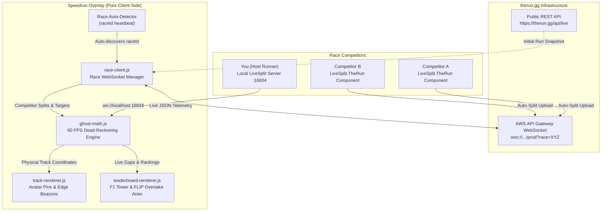
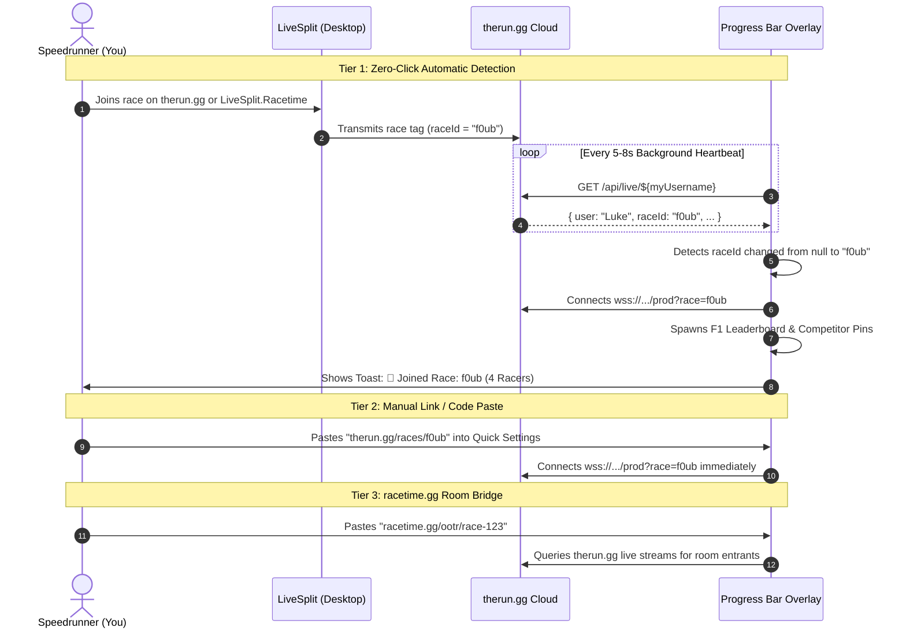

# Proposal: Live Race Ghost Pins & F1-Style Dynamic Leaderboard

* **Status**: Proposed / Feasibility Complete (Post-v1.0.0 Milestone)
* **Author**: Antigravity (Google DeepMind) & [@lukeroddis](https://github.com/lukeroddis)
* **Target Platforms**: therun.gg, racetime.gg, LiveSplit.TheRun

---

## Executive Summary
This document specifies the architecture and technical design for connecting **Speedrun Overlay** to live online speedrun races. It introduces two synchronized visual systems:
1. **Live Race Ghost Pins**: Online competitors glide along your Progress Track with their Twitch avatars and live split deltas.
2. **F1-Style Dynamic Animated Leaderboard**: A broadcast-grade timing tower displaying real-time positions (P1, P2...), live gaps/intervals, current split sectors, and smooth FLIP overtake reordering animations.

> [!IMPORTANT]
> **Key Technical Findings**:
> - **therun.gg has a dedicated Race WebSocket**: Connecting to `wss://fh76djw1t9.execute-api.eu-west-1.amazonaws.com/prod?race=${raceId}` streams real-time updates for all race participants.
> - **Zero-Click Race Auto-Detection**: Live runs on therun.gg carry a `"raceId"` attribute. By monitoring the runner's profile, the overlay detects the exact moment the user joins a race, automatically opening the F1 leaderboard and spawning competitor pins without manual URL entry.
> - **CORS & Pure Client-Side**: The REST endpoints (`https://therun.gg/api/live`) and AWS WebSocket gateway allow wildcard browser access (`Access-Control-Allow-Origin: *`), requiring zero backend servers, local proxy servers, or Node.js dependencies.

---

## 1. Platform Comparison & Hybrid Architecture

| Capability | **therun.gg** | **racetime.gg** |
| :--- | :--- | :--- |
| **Live Split Telemetry** | **Yes** (pushed on every split action) | **No** (only start & `.done` finish) |
| **Live Time / Pacing** | **Yes** (`currentTime`, `delta`, `currentSplitIndex`) | **No** (only race start timestamp) |
| **Runner Comparison Curves** | **Yes** (full PB, Best Segments, Average arrays) | **No** |
| **WebSocket API** | `wss://fh76djw1t9.execute-api.eu-west-1.amazonaws.com/prod` | Private socket.io chat room |
| **REST API & CORS** | `https://therun.gg/api/live` (`CORS: *` wildcard) | `https://racetime.gg/<cat>/<race>/data` (restricted CORS) |
| **LiveSplit Integration** | `LiveSplit.TheRun` (bundled by default in LiveSplit since March 2024) | `LiveSplit.Racetime` (bundled by default) |
| **Avatars & Profiles** | **Yes** (Twitch profile pictures in 150x150 PNG) | Yes (user avatars) |



---

## 2. Live Telemetry Schema (therun.gg)

When querying `https://therun.gg/api/live/${username}` or listening to the WebSocket stream, each racer transmits a rich payload:

```json
{
  "user": "fombon20",
  "login": "fombon20",
  "game": "Portal 2",
  "category": "Single Player",
  "startedAt": "1792012693774",
  "currentTime": 1549450.0732,
  "currentSplitIndex": 24,
  "currentSplitName": "-Laser vs. Turret",
  "delta": 113849.9756,
  "pb": 4042366.9433,
  "hasReset": false,
  "raceId": "f0ub",
  "picture": "https://static-cdn.jtvnw.net/jtv_user_pictures/9018f5c6-8f92-411b-99b3-profile_image-150x150.png",
  "splits": [
    {
      "name": "-Container Ride",
      "splitTime": 335183.3496,
      "comparisons": {
        "Personal Best": 334950.0122,
        "Best Segments": 334816.0,
        "Average Segments": 340482.8911
      }
    },
    {
      "name": "-Laser vs. Turret",
      "splitTime": null,
      "comparisons": {
        "Personal Best": 1475100.0976,
        "Best Segments": 1383665.8231
      }
    }
  ]
}
```

> [!NOTE]
> All timestamps in therun.gg are delivered in milliseconds (`ms`). The overlay translates these to seconds (`sec = ms / 1000`) for consistency with LiveSplit server responses.

---

## 3. Sub-Second Pinpoint Positioning Mathematics

Because **therun.gg delivers historical split times and target comparison curves**, competitor pins can be positioned with sub-second accuracy using **60 FPS Dead-Reckoning**.

### Strategy A: Split-Anchored Segment Interpolation (Exact Match)
When both runners use matching split structures (standard community splits):
1. **At Split Milestones**: When Competitor $B$ hits Split $K$, therun.gg emits their split event. Their pin immediately anchors to Split Node $K$.
2. **Between Splits (In-Flight)**: 
   - Previous completed split timestamp: $T_{\text{prev}} = \text{splits}[K-1].\text{splitTime}$
   - Expected segment target timestamp: $T_{\text{target}} = \text{splits}[K].\text{comparisons}[\text{"Personal Best"}]$
   - Expected segment duration: $D = T_{\text{target}} - T_{\text{prev}}$
   - Competitor's current elapsed run time: $T_{\text{now}} = (\text{Date.now()} - \text{startedAt})$
   - Segment Progress Ratio:
     $$R = \text{clamp}\left(0, \frac{T_{\text{now}} - T_{\text{prev}}}{D}, 1.0\right)$$
3. **Screen Positioning**:
   - The pin coordinate is computed identically to our existing ghost engine:
     $$\text{Coord} = \text{Node}_{K-1} + R \times (\text{Node}_K - \text{Node}_{K-1})$$
   - On every animation frame (`requestAnimationFrame` at 60 FPS), $T_{\text{now}}$ advances locally, so the competitor's pin glides continuously along the track rather than jumping only when a split event fires.

### Strategy B: Universal Time-Pacing Projection (Mismatched Splits Defense)
If Competitor $B$ uses 14 splits while you use 10 splits:
1. Take Competitor $B$'s current elapsed time $T_{\text{now}}$ (e.g. 5m 20s).
2. Locate where 5m 20s falls on **your current target comparison track** (e.g. your Personal Best curve).
3. Place Competitor $B$'s pin at that exact physical position on your track.
4. **Result**: You always see where Competitor $B$ is relative to your run, regardless of differences in naming or split count.

---

## 4. Race Auto-Detection Lifecycle



---

## 5. Dynamic F1-Style Animated Leaderboard

### Visual Layout
The leaderboard renders as a broadcast-style timing tower (docked on the right edge or floating):

```
+--------------------------------------------------------------+
| 🏁 RACE: SM64 120 STAR (4 RACERS)                     [✕]    |
+--------------------------------------------------------------+
| [P1] 🥇 🖼️ SimpleFlips    1:14:22.4  | S8: Shifting Sand     |
| [P2] 🥈 🖼️ Luke (YOU)       +0.8s     | S8: Shifting Sand ▲   |
| [P3] 🥉 🖼️ Cheese051       +12.4s    | S7: Lethal Lava       |
| [P4] 4  🖼️ Boreal          +1:04.1   | S6: Hazy Maze Cave    |
+--------------------------------------------------------------+
| [✓ Toggle All]  [Top 3 Only]  [Proximity ±15s]               |
+--------------------------------------------------------------+
```

### Dynamic Ranking Calculation
$$\text{Score} = \text{CurrentSplitIndex} + \text{InSegmentProgressRatio}$$
- If Runner A is at Split 4 with ratio 0.65 $\rightarrow \text{Score} = 4.65$.
- If Runner B is at Split 4 with ratio 0.40 $\rightarrow \text{Score} = 4.40$.
- Runner A occupies P1.
- **Live Intervals**: Difference in time vs the P1 leader (`+0.8s`) or car directly ahead (`INT +0.4s`) updates at 60 FPS.

### Smooth FLIP Overtake Animations
To prevent layout thrashing and maintain 60 FPS, the tower uses the **FLIP (First, Last, Invert, Play)** pattern:
```javascript
function updateLeaderboardPositions(newOrder) {
  const oldRects = new Map();
  document.querySelectorAll(".leaderboard-row").forEach(el => {
    oldRects.set(el.dataset.userId, el.getBoundingClientRect().top);
  });

  newOrder.forEach(userId => container.appendChild(rowElements.get(userId)));

  newOrder.forEach(userId => {
    const el = rowElements.get(userId);
    const oldY = oldRects.get(userId);
    const newY = el.getBoundingClientRect().top;
    const deltaY = oldY - newY;

    if (deltaY !== 0) {
      el.style.transform = `translateY(${deltaY}px)`;
      el.style.transition = "none";

      requestAnimationFrame(() => {
        el.style.transition = "transform 0.45s cubic-bezier(0.2, 0, 0, 1)";
        el.style.transform = "translateY(0)";
        if (deltaY > 0) el.classList.add("overtake-up");
      });
    }
  });
}
```

---

## 6. Master & Individual Racer Controls

### 1. Master Killswitch
- **Settings Toggle**: `Race Overlay: [Enabled / Disabled]` switch in Quick Settings.
- **Global Hotkey**: Pressing `Shift + R` toggles the race overlay on/off instantly.
- **Clean Disconnect**: Hides competitor pins from the track, collapses the leaderboard, and disconnects the WebSocket to conserve resources.

### 2. Interactive Individual Toggles
- **Click-to-Mute on the Leaderboard**: Clicking any racer's row on the F1 Leaderboard toggles their visibility on the Progress Track. Muted rows dim to 40% opacity with an eye-slash icon (`👁️‍🗨️`).
- **Quick Settings Participant List**: Individual checkboxes for each entrant with color badge pickers.
- **Proximity & Preset Filters**: Quick filters for large lobbies:
  - `[All]`: Show all competitors.
  - `[Top 3 Only]`: Podium contenders only.
  - `[Proximity ±15s]`: Dynamic filter displaying only racers within 15 seconds of the user.

---

## 7. Phased Implementation Roadmap

```
Phase 1: Telemetry & Auto-Detection
 ├── src/core/race-client.js: WebSocket manager for wss://.../prod?race=XYZ
 ├── Heartbeat poller for user's raceId
 └── In-memory competitor telemetry cache

Phase 2: Ghost Pins & Dead-Reckoning
 ├── Circular avatar pin rendering on Progress Track
 ├── 60 FPS Dead-reckoning segment interpolation in src/core/ghost-math.js
 └── Off-screen edge beacons for distant competitors

Phase 3: F1-Style Dynamic Leaderboard
 ├── #hud-comp-leaderboard markup & glassmorphic styling
 ├── 60 FPS live gap & interval calculations
 ├── FLIP smooth overtake position reordering in src/ui/interactions.js
 └── Interactive click-to-mute & preset filter pills
```
